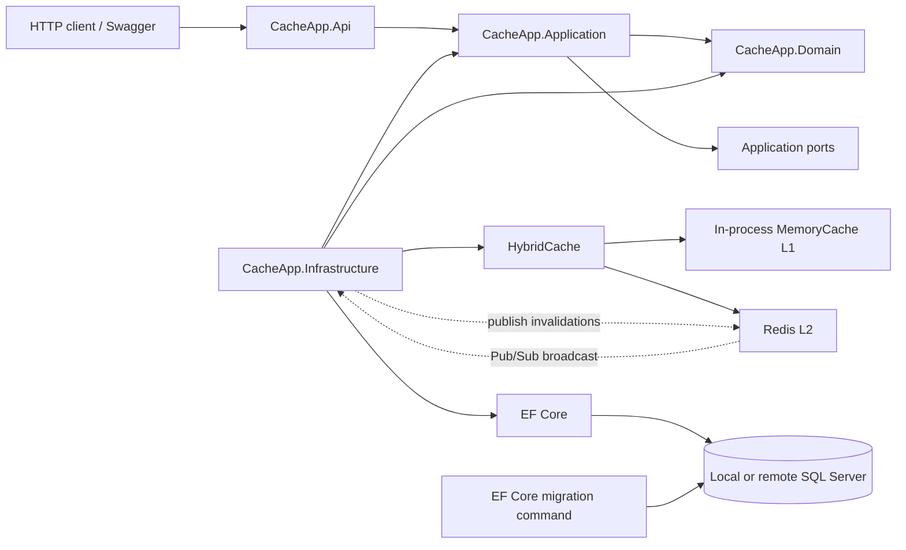
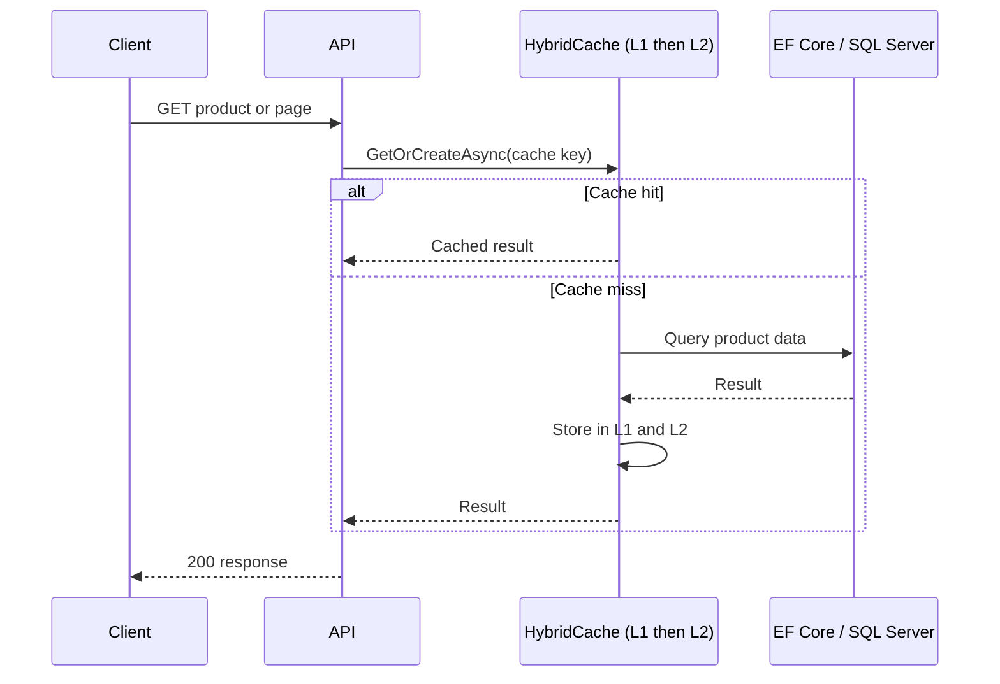

# Architecture

## Status and scope

This is the approved architecture for the product-caching demo API, including the separate-project Clean Architecture amendment approved on 2026-11-17. Implementation Planning is approved. Construction is in progress; the solution identity rename builds successfully, formatting passes, and eight tests pass. One SQL Server/Redis integration test remains skipped because external connections are not configured.

The solution identity rename to `CacheApp` was approved at Requirements Definition and Architecture and Design on 2026-11-18. It changes solution/project names, project paths, assembly names, and namespaces only. Product-specific API contracts, database schema, migration IDs and operations, and cache behavior are unchanged.

## System overview

The API runs as a local .NET 11 process. It connects to an externally installed SQL Server for durable product data and to a Redis instance started separately with the repository's Redis-only Docker Compose configuration.

Dependencies point inward: Domain has no project dependencies; Application depends on Domain; Infrastructure implements Application ports and depends on Application and Domain; API is the composition root and depends on Application and Infrastructure. Each layer is a separate .NET project so these boundaries are enforced at compile time. The test projects remain separate.

### Project responsibilities

- **CacheApp.Domain:** Product entity and domain invariants. No dependencies on other solution projects or infrastructure packages.
- **CacheApp.Application:** Product use cases, request/response contracts, validation, and ports for persistence and caching. Depends only on Domain; it does not reference EF Core, Redis, HybridCache implementations, or ASP.NET Core.
- **CacheApp.Infrastructure:** EF Core SQL Server persistence and migrations, HybridCache/Redis implementations, Pub/Sub invalidation, cache configuration, and dependency health adapters. Implements Application ports and depends inward on Application and Domain.
- **CacheApp.Api:** Minimal API endpoints, HTTP-specific binding/Problem Details, health endpoint mapping, and dependency injection composition root. Delegates product behavior to Application and registers Infrastructure.

### Solution identity rename

- Rename `ProductCaching.slnx` to `CacheApp.slnx`.
- Rename source projects and directories to `CacheApp.Domain`, `CacheApp.Application`, `CacheApp.Infrastructure`, and `CacheApp.Api`; rename unit and integration test projects/directories to `CacheApp.UnitTests` and `CacheApp.IntegrationTests`.
- Set assemblies and code namespaces to the corresponding `CacheApp.*` names. Update solution membership, project references, scripts, HTTP request variables, and documentation paths/commands together.
- Update EF migration and snapshot CLR namespace/type references to the new namespaces without changing migration IDs, SQL operations, seed values, table names, or database schema.
- Treat this as a source-level rename: callers must rebuild against the new assemblies/namespaces. No compatibility assemblies or duplicate old project names are part of the design. HTTP routes and serialized contracts do not change.

## Components and data flow

- **HTTP API:** ASP.NET Core Minimal APIs expose product CRUD and health endpoints. Endpoint handlers validate and translate HTTP input/output, then call product use-case services.
- **Product use cases:** Application use cases coordinate product operations through persistence and cache ports. They do not reference EF Core or concrete cache providers and do not introduce CQRS or a generic repository beyond focused ports needed for persistence and cache-aside behavior.
- **Persistence:** Infrastructure's `ProductDbContext` maps the product table using EF Core SQL Server. Migrations are authored in Infrastructure and applied manually with the API project as startup project. The initial migration inserts the 20 deterministic sample products; API startup performs no migration or seeding.
- **Caching:** Infrastructure implements the Application cache port using HybridCache, with the default in-process MemoryCache as L1 and StackExchange Redis as L2. Detail and list reads use `GetOrCreateAsync`; the factory delegates source loading to the persistence port only after L1 and L2 miss. HybridCache coalesces concurrent factories for a key within each running process.
- **Cross-process invalidation:** Each API process uses one long-lived Redis connection multiplexer for distributed caching, Pub/Sub, and health checks, and subscribes to a Redis Pub/Sub invalidation channel. After a product write commits and the writer invalidates its own detail key and list tag, it publishes a versioned message containing the product ID and writer instance ID. Connected processes ignore their own messages and otherwise remove the detail key and invalidate their list tag in their own HybridCache instances. Every product cache entry also has a shared `products` tag. On Redis reconnection, a process invalidates that tag locally before cache reads resume.
- **Redis setup:** A Redis-only `compose.yaml` starts Redis on the standard local port. The API is run separately and reads Redis and SQL Server connection strings from environment configuration or user secrets.

### Read and write flow

A successful create, update, or delete first commits to SQL Server, then removes the matching detail key and invalidates the product-list tag in the writer process and Redis. It then publishes a Redis Pub/Sub notification for other API processes to invalidate their local L1 entries. During normal Redis connectivity, a connected process receives the notification and subsequent reads reload the current database state. Redis Pub/Sub is at-most-once: a process disconnected during publication can miss the event. If only that process's subscription is disconnected, its L1 may remain stale until the 10-second local TTL expires; when Redis reconnects, the process invalidates its local product tag before cache reads resume. A stopped process has no surviving L1 cache; on restart, it follows the current L2 state, which the writer invalidates when Redis is available. If Redis itself is unavailable during the write, the shared L2 entry may also remain until its 30-second expiration. The write remains successful once SQL commits; invalidation or publication failures are logged. These TTL bounds and reconnect invalidation are the selected availability/freshness tradeoff for review.

## HTTP contract

Base route: `/api/products`.

| Method and route | Behavior | Success response |
|---|---|---|
| `GET /api/products?page=1&pageSize=10` | Return one page of products; defaults are page 1 and 10 items. `pageSize` is limited to 50. | `200` with `{ items, page, pageSize, totalCount }` |
| `GET /api/products/{id}` | Retrieve one product by GUID ID. | `200` product or `404` |
| `POST /api/products` | Create a product. | `201` with product and `Location` header |
| `PUT /api/products/{id}` | Replace editable product fields. | `204` or `404` |
| `DELETE /api/products/{id}` | Delete a product. | `204` or `404` |
| `GET /health/live` | Process liveness. | `200` |
| `GET /health/ready` | Check SQL Server, Redis, and invalidation-subscriber readiness. | `200` when dependencies and subscriber are ready; otherwise `503` |

Invalid pagination or product input returns `400` with Problem Details. Product IDs are GUIDs generated by the API. The initial product shape is `Id`, `Name`, `Description`, `Price`, and `StockQuantity`; `Name` is required (maximum 120 characters), `Description` is optional (maximum 500 characters), and price and stock quantity must be non-negative. Monetary values use SQL `decimal(18,2)`. The list sorts by ascending ID for deterministic pages. These details are proposed API decisions for review.

## Persistence and migrations

- Table: `Products`, with GUID primary key; required name; optional description; decimal price; integer stock quantity.
- EF Core SQL Server provider owns mappings and schema migrations.
- The initial migration inserts 20 products with fixed GUIDs and values. API-created products receive GUIDs generated by the API before persistence.
- Create migration source files in Infrastructure with `dotnet ef migrations add <MigrationName> --project src/CacheApp.Infrastructure --startup-project src/CacheApp.Api`, review them, and commit them with the application source. The API is the startup project used to supply design-time configuration.
- A developer or operator manually applies the committed migrations to the configured SQL Server with `dotnet ef database update --project src/CacheApp.Infrastructure --startup-project src/CacheApp.Api`. This command changes the target database; it is a separate, explicit database update step, not migration authoring.
- Do not call `Database.Migrate` or create seed data from API startup.
- Keep connection strings out of committed files. Document environment-variable and user-secrets configuration for both SQL Server and Redis.

## Cache design

- **Keys:** `products:item:{id}` for details and `products:list:{page}:{pageSize}` for pages. Keys include every query input that changes a result.
- **Tags:** Every product entry has the umbrella `products` tag. Every list page also has `products:list`, and each detail entry has a per-product tag such as `products:item:{guid}`. The writer removes the detail key directly and invalidates the list tag. Pub/Sub subscribers remove the corresponding detail key and invalidate list results in their local HybridCache instance. Reconnection invalidates `products` to force all product values through the source again.
- **Expiration:** Proposed defaults are 30 seconds for L2 and 10 seconds for L1, configurable through cache settings. Both list and detail results use these short lifetimes.
- **Stampede control:** Use HybridCache `GetOrCreateAsync` for every cache-aside read. Its per-process coordination shares one factory execution among concurrent requests in that process for the same key. Separate processes may each execute one SQL factory for a simultaneous cold miss; no distributed lock is included.
- **L1 capacity and LRU:** Configure MemoryCache with a size limit of 20 demo units. Use .NET 11 HybridCache `LocalSize` to charge one unit per detail result and one unit per product in a list result. Keep entries at normal priority; MemoryCache compaction removes expired entries first and then the least recently used entries within priority buckets. This is LRU compaction under capacity pressure, not an exact fixed-size LRU data structure. Use the seeded products and constrained capacity to make eviction observable.
- **Serialization:** Use HybridCache's default `System.Text.Json` serialization for product and page response DTOs.
- **Failure handling:** SQL Server remains authoritative. Cache factory, invalidation, and publication failures are logged with structured context. A committed write returns success even if invalidation fails. If a process misses a Pub/Sub event, its old L1 value expires within the 10-second local TTL; if Redis invalidation was unavailable, an old L2 value expires within the 30-second distributed TTL. Reconnect recovery invalidates the local product tag before cache reads resume. Cache/SQL dependency readiness is reported by `/health/ready`.

## Security, errors, and observability

- No authentication or authorization is included for this local demonstration.
- Validate requests at the API boundary and return consistent Problem Details responses for validation and unexpected failures.
- Use structured logs. Log cache-factory database loads as cache-miss evidence; ordinary cache hits do not generate application-level miss logs. EF Core logs can be enabled through standard logging configuration.
- Never log connection strings or credentials. Use environment variables or .NET user secrets for local configuration.

## Deployment and operation

1. Start Redis using the Redis-only Docker Compose file.
2. Configure SQL Server and Redis connection strings outside source control.
3. Manually apply the committed EF Core migrations to the target SQL Server; this creates the schema and inserts the fixed sample records.
4. Run the API on the host with `dotnet run`.
5. Exercise CRUD, paging, TTL, invalidation, stampede, and L1 capacity behavior through Swagger or HTTP requests; use logs and repeated requests to observe SQL factory calls.

Local run instructions use one API process, but the architecture supports multiple API processes sharing the same Redis instance. HybridCache stampede coordination remains per process; simultaneous cold misses in different API processes can each invoke the SQL factory once. Deployment itself is outside scope.

## Approved architecture decisions

- Use EF Core and SQL Server migrations for persistence and migration-owned deterministic seed data.
- Use HybridCache with Redis L2 and MemoryCache L1 instead of implementing custom cache orchestration.
- Use separate Domain, Application, Infrastructure, and API projects with inward dependency references, as recorded in [ADR-004](decisions/ADR-004-clean-architecture-project-boundaries.md). This supersedes the original single-project architecture choice.
- Use tag-based list invalidation and direct detail-key invalidation after writes.
- Use bounded MemoryCache size with HybridCache local entry sizing to demonstrate .NET MemoryCache LRU compaction.
- Use Redis Pub/Sub to broadcast product invalidation to connected API processes, with local TTL and reconnect invalidation as recovery for missed messages.
- Limit stampede protection to HybridCache's per-process coalescing; do not add a distributed lock.

The approved decisions and tradeoffs are recorded in [ADR-001](decisions/ADR-001-hybridcache-and-redis.md), [ADR-002](decisions/ADR-002-efcore-migrations-and-seed.md), [ADR-003](decisions/ADR-003-cross-process-invalidation.md), and [ADR-004](decisions/ADR-004-clean-architecture-project-boundaries.md).

## Architecture amendment — multi-process caching (2026-11-17)

The user clarified that the local demo runs one API process but must support multiple API processes for future deployment. The architecture now adds Redis Pub/Sub invalidation, reconnect cache reset, and TTL-bounded stale data when notifications or invalidation are unavailable. Pub/Sub notifications are at-most-once; durable replay is not included. Stampede protection remains per process, with no Redis distributed lock. This revises the prior draft statement that multi-instance operation was out of scope. The amendment and architecture were approved on 2026-11-17.

## Architecture amendment — separate Clean Architecture projects (2026-11-17)

The user directed that each Clean Architecture layer be a separate .NET project. This revises the approved single-project implementation choice; product behavior, requirements, cache strategy, API routes, database schema, and multi-process invalidation behavior remain unchanged. The approved project graph is Domain <- Application <- Infrastructure, with API referencing Application and Infrastructure as the composition root. Existing source files, EF migrations, tests, project references, and CLI documentation were reconciled to this graph. Migrations live in Infrastructure and use the API as the EF Core startup project. The amendment was approved on 2026-11-17.

## Environment findings

- The workspace contains no existing solution, project, `.editorconfig`, or established build configuration.
- .NET SDK `11.0.100` is installed.
- Docker CLI is not currently available on PATH, so running Compose cannot be verified in this environment without Docker becoming available.

## References

- [HybridCache in ASP.NET Core](https://learn.microsoft.com/en-us/aspnet/core/performance/caching/hybrid)
- [HybridCacheEntryContext.LocalSize (.NET 11)](https://learn.microsoft.com/en-us/dotnet/api/microsoft.extensions.caching.hybrid.hybridcacheentrycontext.localsize?view=net-11.0-pp)
- [MemoryCache eviction and compaction](https://learn.microsoft.com/en-us/aspnet/core/performance/caching/memory)
- [Redis Pub/Sub delivery semantics](https://redis.io/docs/latest/develop/use-cases/pub-sub/)
